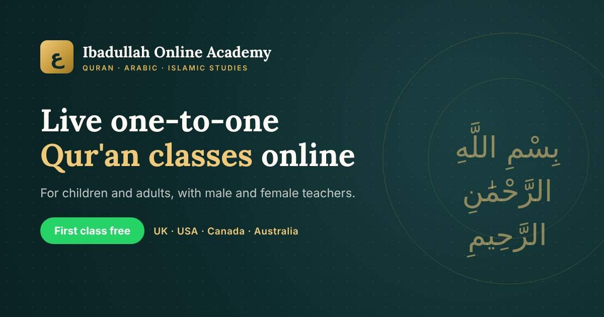

# Ibadullah Online Academy

Website for Ibadullah Online Academy, an online academy teaching live one-to-one Qur'an, Arabic and Islamic Studies classes to children and adults in the UK, USA, Canada and Australia.

**Live site:** https://www.ibadullahacademy.com

## What's in it

- 27 pages: home, 12 program pages, 4 country pages (UK, USA, Canada, Australia), pricing, teachers, about, FAQ, contact, apply, and safeguarding and privacy policies
- A free trial application form and a contact form, each with its own thank-you screen and a WhatsApp follow-up button
- Prices that switch between £, $, CA$ and A$, picked automatically from the visitor's time zone
- Live local clocks on the country pages, so parents see class times in their own time
- A phone-first layout with a booking bar that stays at the bottom of the screen
- Search engine basics: sitemap, structured data, share image and a custom 404 page

## Built with

Plain HTML, CSS and JavaScript. No framework and no build step. Hosted on Netlify and published automatically from this repository.

## Designed and built by

Muhammadmustapha Yusuf, founder of Ibadullah Online Academy.

Other work: the AFIT Muslim Students' Community website, [afitmsc.com.ng](https://afitmsc.com.ng)

Maintainers: please read `HANDOVER.md` before making changes.
